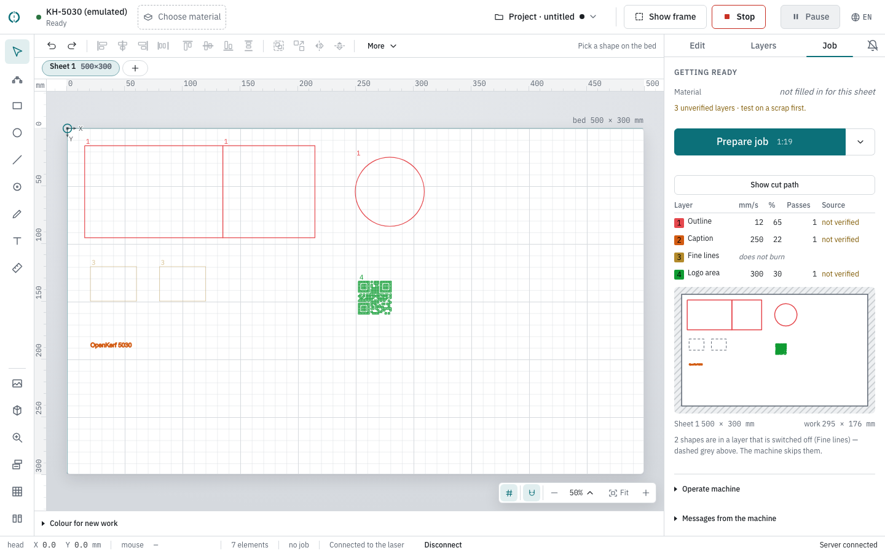
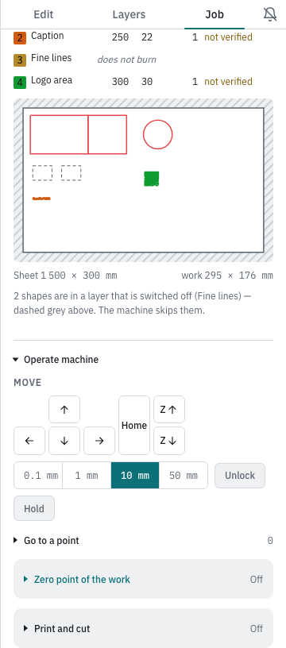

# Burning: the pre-flight, the run, and the machine

Everything that puts light on material lives on the **Job** tab of the right-hand
panel, and in the transport buttons at the right of the top bar. This page walks
that panel from top to bottom: what the pre-flight shows you before anything
moves, how to send the job to a Ruida's own memory instead of burning it from
here, the cut path you can walk through before pressing anything, what the two
taps that start a job do, what you can see and change while the machine is
burning, and the controls for moving the head when it is not.

## Where burning is operated

Three surfaces, and each keeps the same job all the time.

- **The top bar**, on the right: **Stop**, **Pause** / **Resume** and **Show frame**
  — the machine verbs. They never move, so the stop button is in the same place
  whether something is running or not. **Show frame** sits there and only there: the
  pre-flight used to carry a second copy of it and no longer does.
- **The Job tab** in the right-hand panel: the pre-flight before, the progress
  during, and the machine controls under both. **Prepare job** lives here and only
  here, as the one filled button on the tab.
- **The status bar** at the bottom: the head position, your pointer position, how
  many elements the design holds, how much time is left, whether the machine is on
  the line, and **Server connected** for the separate connection from this page to OpenKerf. The machine connection is named beside the machine in the header. It is the same on
  every tab, so you never have to switch tabs to read the progress or the count.

**Prepare job** does not open a window. It arms the pre-flight that was standing
there anyway.

## The pre-flight

As long as nothing is in flight, the Job tab is headed **Getting ready** and
shows the preparation in full. You do not have to press anything to see it, and
it follows your drawing: change a shape and the estimate is worked out again
about half a second later.

It reads top to bottom the way you check a job: what it burns on (the material,
and the zero point or print-and-cut alignment when one is set), what is wrong with
it (the warnings, each in a tinted box with an icon), then **Prepare job** with the
time on it, and then the evidence you can work down — **Show cut path**, the layer
table and the drawing. The button row stays put where it fits; should the warnings
ever run past the foot of the panel, it stops at the bottom edge rather than
scrolling away. Explanations that are reasons rather than instructions wait behind
a **Why?** fold, so they do not push the buttons down on a tablet.

### Time, material and zero point

**How long it takes** stands on the start button, under the warnings, and
nowhere else: "Prepare job 1:19". The engine works it out by building the whole cut
plan, and while it does that the last known time stays where it is, at the contrast
it always has, with a small ellipsis after it: "Prepare job 1:19…". The button keeps
its width through that, so nothing moves under your cursor, and a screen reader
hears the sentence "A new estimated time is being worked out." Hiding the number
made the button change width on every edit, and a second copy of it higher up the
panel put the same minutes on the screen twice, 400 px apart.

**With a series attached** the time on the button is one plate, and a line above it counts
the afternoon: "This is the plate now on the bed; the 3 burns still to go take about
1:12 together." Both numbers come off the same estimate, so the two cannot drift
apart, and the line only appears when there is more than one plate to go — with one
it would say the same number twice. It also describes the plate that is coming and
not the drawing as it stands: on the last plate of a sheetful, the places the list
has no rows left for are already taken out of it. See
[Variable text](variable-text.md#the-run).

**Material** shows the material and thickness of the sheet you are burning on, or
*not filled in for this sheet*. The line is always there, because saying nothing
reads as "not needed" — and then you run a birch preset on acrylic.

**Zero point** only appears when one is set, with its coordinates in
millimetres. A zero point moves your work on the bed, and this is the last screen
before it burns.

**When it goes wrong.** If the estimate is slow the panel says: "The engine builds
the whole cut plan to estimate this; on a heavy design that takes a moment.
Starting works regardless — the machine does not wait for it."

### The layer table

One row per layer, with a coloured chip carrying the layer number — the same
number and colour as on the canvas and in the Layers tab. Then the four things a
laser cutter checks before putting material in the machine: **mm/s**, **%**,
**Passes** and **Source**.

Source says where those numbers came from, in two words: *measured*, *not
measured*, *extrapolated — not measured*, *set by hand*, *from someone else's
machine*. If the preset was measured but on a different board, it says *other
material* or *other thickness* instead — because "measured" above a number that
was measured on something else reassures where it should not.

A layer this server cannot carry out shows *does not burn* across the whole row
instead of speed and power. So does a layer you switched off yourself: it is in
the table, with its number and colour, and with those same three words where its
speed and power would be. It used to be left out of the table altogether, which
made a layer full of shapes look like no layer at all.

With the warnings above the start button, a compact confidence note identifies unverified layers: "3 unverified layers · test on a scrap first." Each affected row keeps its source label.

Beside it, the objections, in one amber box: one line per layer, heaviest first, and
when the top one really outweighs the bottom one it carries the badge **First**.

**When it goes wrong.** Raster layers do not burn on this server. The pre-flight
says so before you start: "This server cannot burn raster layers." followed by
'The layer "Logo area" produces nothing — the converter from raster area to laser
lines lives in the wxPython version of the engine. The clock below therefore
counts zero for it. Make it an engrave or cut layer, or burn this job from the
wxPython UI.'

### With a rotary fitted

A rotary changes the shape of what comes out, so it is said out loud on the one
screen you read before burning. Above the start button: "The rotary is on: a chuck
of 80 mm, Y scaled by 1.036." — or, on rollers, "The rotary is on: 251.3 mm round,
Y scaled by 1.036." And if the work is taller than the object is round, a second
line: "The work is 300 mm tall and once round is 251.3 mm, so the end burns over
the beginning."

Everything about setting one up, calibrating it and the order to do it in is on
its own page: [The rotary](rotary.md).

### The drawing

At the foot of the column, under the table: what is going to be burned, drawn on
the sheet. The sheet is the
plain rectangle; everything beyond its edge is hatched, because there is no
material there. Each shape is drawn in the colour of its layer. A shape in no
burning layer is dotted grey — the machine will skip it.

Tap the drawing to open it large in a window headed **What gets burned**.

Under it are two sizes: the sheet with its measurements, and **work** with the
measurements of everything on it. That second number is the one you hold against
your offcut.

Then, in words, what the picture says. There are three of these, and the order is
deliberate:

- **Outside the bed.** followed by, for one shape, "One shape lies outside the
  reach of the machine, which reaches to 500 × 300 mm. The head does not go
  there: move or scale it." In a red box, and it is the worst of the three: the
  machine cannot get there at all.
- "One shape falls outside Sheet 1. There is no material there — whatever sticks
  out burns into your honeycomb or your bench." In an amber box. You lose the
  workpiece, not the machine.
- "One shape sits in no layer that burns — dashed grey above. The machine skips
  it." Grey; a statement, not a warning.
- "2 shapes are in a layer that is switched off (Fine lines) — dashed grey above.
  The machine skips them." Grey as well, and a separate sentence because the way
  out of it is another one: the shapes have a layer, the layer has its switch off.

### The checklist

Three lines under the heading **Run through this**: *Lid closed*, *Extraction and
air assist on*, *Workpiece is clamped and flat*. There is nothing to tick. A
checklist you get used to ticking off protects nobody.

You meet it on the tap that arms the burn. Press **Prepare job** and the button
row grows the three lines, directly above the **Start now** that fires — the
moment between the two taps is the moment you walk round the machine. Cancel, and
the row is the two buttons again.

### Sending the job to the machine

The start button has a second part: a narrower, plain button with a downward arrow,
joined to its right-hand end. It opens a small menu with one line in it, **Send to the
machine**, and that line does the other thing you can do with a job that is ready:
instead of burning it from here, it puts it in the machine's own memory as a file and
leaves it standing there. The arrow itself does nothing to the machine, and the start
button beside it keeps its two taps.

The line opens a window of the same name. A **Why?** fold at its top says what will
happen, and the same sentence is the tooltip on the button that does it: "The file goes into the machine
and stays there. You start it on the machine’s own panel — nothing burns from here."

That is the point of it. Once the file is in the machine, nothing has to stay
attached while it burns — no laptop on a stool beside the machine, no cable to
trip over, no sleeping screen halfway through an hour of engraving. You walk to
the machine, pick the file on its panel and press start there.

This is a Ruida thing. On any other machine the line in the menu is greyed out and
its tooltip says why: "This machine does not keep files in memory; that is a Ruida
thing."

> **The app sends. The app does not start.** There is no route in OpenKerf that
> begins a job in the machine's memory, deliberately. Whatever is sent waits until
> a hand on the machine's own panel starts it — which is also why this is one tap
> and starting is [two](#starting-two-taps-never-one). Sending sets nothing in
> motion, so a confirmation in front of it would only teach you to click through
> confirmations.

**Name on the machine.** The field in the window is filled with the name of the
sheet and you can type over it. What the machine keeps of a name is short:
**at most eight characters, capitals, letters and digits only**. The field applies
that rule as you type rather than afterwards, so what stands in the box is exactly
what will stand on the panel. Type `kastje-groot` and the box reads `KASTJEGR`;
`my box` becomes `MYBOX`. Accented letters, punctuation and spaces do not arrive
at all — a character that never appears is one keystroke to notice, where a name
silently changed on the way is not. With the field empty the button is off and
says "Type a name first".

Press **Send** and it reads *Sending…* while it goes. When it is done a green line
appears under the field, with the name the machine confirmed rather than the one
that was typed: "{name} is in the machine. Start it on the panel." That line goes
as soon as the name in the field changes, because it is about one file under one
name. Close the window with its cross or with Escape; the file stays where it is.

#### When it will not go

Two things stop it before you can press at all, and the greyed-out line in the menu
says which in its tooltip: **while a job is running** ("Not possible while a
job is running" — the file would go down the same cable the machine is burning
from), and **on a machine that is not a Ruida** ("This machine does not keep files
in memory; that is a Ruida thing"). The same for an empty bed and for a server that
cannot be reached.

One thing you can press and it will still refuse, because the screen cannot see it:
another file of yours is already on its way to the same machine. "This machine is
already being sent a file. Wait until that one is done and press again; nothing has
been sent." Two at once interleave into one file made of two jobs.

While the file goes out, OpenKerf stops asking the machine for its status, so
nothing of its own lands between two packets of the file. A command already on its
way finishes first; nothing is thrown away to make room. If the line cannot be had
within two seconds, the request refuses before anything is sent.

Each packet waits for the controller's acknowledgement before the next one goes,
the last one included. An acknowledgement says the controller took the packet, not
that anything burned. A packet that is not acknowledged stops the transfer, and the
sentence says what is then on the panel; OpenKerf never sends that packet a second
time, and never carries on with the rest of the file after reconnecting.

Sending needs a connected machine. A line that is reconnecting by itself — after a
short silence of the controller — is waited for, up to eight seconds; a machine
that is simply not connected is refused at once, because nothing is going to
connect it: "There is no connection to the machine, so the file cannot be sent.
Connect first; nothing has been sent." Press **Connect** and send again.

The refusal for a job on the machine is written out as a whole sentence as well — "A
job is on this machine — burning, or waiting in the queue to start. Wait until it is
done, or stop it: the file would go down the same connection that job uses. Nothing
has been sent." — but you will meet it through the API rather than on this screen,
because the button is already grey by then. It is the same answer, said to whoever
asked. It names the queue as well as the burning, because a job that has been handed
to the machine and not yet begun is about to use that same connection.

The other direction has a sentence too, and you can meet it on any screen: press
anything that talks to the machine while a file is going out — a jog arrow, Burn,
Pause — and you get "A file is being sent to the machine. Wait until it is there and
then try again: anything sent now lands in the middle of that file, and the machine
gives no sign of it." Stopping is the one exception and stays available throughout:
a stop that first argues about the connection is not a stop. It does spoil the file
that was on its way, so delete that one from the panel before burning it.

One more can only turn up after you have pressed, because nothing on the screen can
see it coming: "This job holds a single command of 1201 bytes, and a block may be at
most 1000. The machine would silently keep only the first part of it, so nothing has
been sent." The job travels in blocks, and a block is never cut through the middle of
a command — so one command longer than a whole block cannot be sent without the
machine quietly keeping the front of it and throwing the rest away. On the designs
this app makes the longest command is 16 bytes, so this is a guard rather than a
thing you meet; if you do meet it, the job needs simplifying and nothing was sent.

#### When it stops halfway

The job goes over in blocks, and a machine that stops taking them or stops
answering breaks off the transfer: "The machine stopped taking the file after 3 of
6 blocks." or "The machine stopped answering after 3 of 6 blocks." Behind that
number comes the part you act on, and it is not the number that decides which of
the four you get but what actually went down the line:

- nothing had gone out yet — "Nothing had gone out, so there is no file on the
  panel to clean up; send it again."
- the name went out and no more — "The name went out but no part of the job
  followed it, so the panel may be showing an empty file under that name: delete
  it there if it is. None of the job itself was sent." The machine opens the file
  on the name, so there can be an empty one under it.
- part of the job went out — "What is on it now is incomplete: delete the file on
  the panel before you burn anything."
- all of it went out and only the last acknowledgement did not come back — "Every
  block went out, including the one that closes the file, but the last one was not
  acknowledged. The file on the panel may be whole and may be missing its end: look
  at it there, and send it again if you are in any doubt."

The first two both say "0 of 6 blocks" and ask for opposite things, which is why
they are two sentences and not one.

#### What has been tried on a real machine

On the KH-5030 (a Ruida RDC6442S on the network), with no other program connected
to it: a 20 × 10 mm rectangle under the name `OKTEST` went over in one block of 433
bytes, every packet acknowledged within 0.02 s, the laser did not start, and the
panel listed the file under that name.

Before that the conversation was built and measured against the engine's own Ruida
emulator, where the file arrives byte for byte identical to the job OpenKerf built
for it — minus `SET_FILE_SUM`, which the emulator answers itself instead of keeping:
measured on one build, 5462 bytes sent and 5455 kept. There is no `.rd` file to
compare against; OpenKerf does not export one.

Not tried on the machine yet: a large file of many blocks, and a transfer cut off
halfway by a pulled cable. Until then, the sentences under
[When it stops halfway](#when-it-stops-halfway) are what the emulator showed.

### Nothing to burn

On an empty bed there is no clock, no checklist and no start button — only
**There is nothing to burn** with: "The bed is empty, or everything on it sits in
a layer that does not burn. Draw or import something, give it a layer, and come
back here."

## The cut path

The pre-flight says *what* burns. The cut path says *in what order*, *where the
head goes without burning*, and *how the time adds up*. It is a workspace you look
at and compare in, so it opens in a window of its own, headed **Cut path**.

Three ways in, and they are the same window:

- **Show cut path** heading the layer table in the pre-flight — beside the layers
  whose order it is about, and the moment you actually want it, just before pressing
  start.
- The same row in the right-click menu on the empty bed, for while you are still
  drawing.
- **⌥P** (Alt+P on Windows and Linux), from anywhere on the bed.

All three carry the same explanation: "See in what order the machine burns, where
the head travels without burning, and how the time builds up".

![The Cut path window. On the bed, a red square with a smaller red square inside it, a second red square to its right, an engraved bar below them, dashed grey lines running from one to the next, and the numbers 1, 2, 3 and 4 — the 1 on the inner square, the 2 on the one around it. The first two are drawn in solid red, the other two faint; a filled dot sits on the left edge of square 2. Under the drawing a Play button, a scrubber at 0:40 of 1:19, the line "The replay runs 4 times faster than the machine.", and four figures: On the clock 1:19, Burning 1,270 mm, Travelling 352.7 mm · 4%, Contours 4.](images/29-cutpath.png)

### What the picture means

The bed is the plain rectangle, the sheet the dashed one — the same two rectangles
the canvas draws, so you can find yourself. Everything else is the job as the
machine has been given it:

- **A contour in its layer colour.** The same colour as on the canvas and in the
  Layers tab, so a third scheme does not have to be learned. Faint is still to
  come; solid is already burned at the moment the scrubber is on.
- **A raster layer as an area,** not as an outline. That is the one distinction
  that decides whether the head sweeps for six minutes or cuts for six seconds,
  and a filled rectangle looks exactly like a cut-out one otherwise.
- **The numbers are the order.** Numbers rather than arrows: an arrow gives a
  direction, and the question is which one comes *first*. A small shape inside a
  large one should be number 1 — if it is not, the part falls out of the sheet
  before its own edge is cut.
- **The dot is the head.** Solid while it burns, hollow while it travels: two
  signals for one state, because on a busy path a colour alone gets lost.

Numbers that would land on top of each other are folded into one: "Numbers that
would cover each other are drawn as one: “7+3” is contour 7 and three more that
start in the same spot. The list below names every contour in order." And past a
certain crowd they are left off altogether: "There are 240 contours, too many to
number on the drawing. Play the path to see the order."

That list is **The order, in words (4 contours)**, folded shut under the figures.
One sentence per contour — "1: Outline, 40 × 40 mm, starting at 60, 60." — with
"walked 3 times" on the end when the layer has passes. It is the only form of the
answer a screen reader can read, and on a crowded drawing it is the readable one
for everybody.

### Travel moves

The dashed grey lines are the head moving with the laser off, from the end of one
contour to the start of the next. The legend calls them "Moving without burning".

They are the reason to open this window at all. Travel costs time and produces
nothing, and the figure to watch is beside the millimetres: **Travelling 352.7 mm ·
4%** — the share of the clock spent not burning. A third of the clock spent
travelling is an ordering problem, and no drawing says that as quickly as one
percentage.

The order itself comes from the engine's own optimisation, not from OpenKerf, and
this window does not change it. What it does is let you see it before the machine
does — and what it shows is the job the spooler is handed, step for step and in the
same order, not a separate drawing that resembles it.

### Playing it back

**Play** runs the head along the path; the scrubber and the clock go with it, and
dragging the scrubber goes anywhere in the job. A replay lasts about twenty
seconds however long the job lasts, and the line under it says by how much that is
cheating: "The replay runs 4 times faster than the machine." — or, on a job of
about twenty seconds, "The replay runs at about the speed of the machine."

### What the clock does and does not promise

Four figures under the drawing: **On the clock**, **Burning** (millimetres with the
laser on), **Travelling** (millimetres and the percentage) and **Contours**.

The order and the travel are exact. The clock is not, and the window says so in
its own words, in a fold headed **What this cannot promise.**:

> "The order and the travel are exactly what the
> machine has been given. The clock is the cut plan's own arithmetic, and the
> machine can be slower: the engine mixes its burn model with the pace measured on
> a finished pass, and neither of the two knows how your laser slows down in a
> corner."

It also counts differently from the estimate on the start button, and by more than
a rounding:

> "This clock also counts longer than the estimate on the start button: the plan's
> accounting per step carries the engine's allowance for acceleration and every
> sweep of a raster layer, and the estimate does not. Measured on nine cut squares
> of 30 mm: 2:01 here against 1:51 there, and on one filled area of 60 × 40 mm in a
> raster layer 7:30 here against 0:00 there — the estimate does not see a filled
> area at all."

So the two clocks are put side by side rather than left to be discovered: "On this
design this window says 1:19 and the start button says 1:09." Where they disagree
badly, this one is the one to believe — and a raster layer is where they disagree
badly.

At the foot: "Building this path took 0.01 seconds." Which is the other thing this
window is honest about — it is not free. It builds the whole cut plan, the same
work the estimate does, and on a heavy design that is seconds.

One thing has not been checked against a machine, and it is worth knowing which:
that the head really walks the contours in the order the numbers give. The order
in the window is measured against the cutcode the spooler gets, which is as far as
a computer without a laser can go.

### When it goes wrong

- While it is working: "Working out the path…", and on a big design a second line,
  "This is a big design, so the path takes a while. Starting the job does not wait
  for it." That is not a promise but a design decision: the engine has one cut
  plan, and a job that arrives always wins. Measured at the heaviest design this
  window accepts: a start pressed while it was building answered after two to
  three and a half seconds, and the path usually still finished on its own.
- When a job does take it: "The job itself needed the cut plan, so the path had to
  give way. It comes back on its own."
- With nothing that burns: "Nothing is going to be burned, so there is no path to
  walk."
- Too heavy to walk through beforehand, refused before any work is done: "This
  design is too heavy to walk through beforehand: 8100 segments against a ceiling
  of 8000. Building the path would cost seconds to a minute of work, and the answer
  would run to megabytes.", followed by "Switch a layer off or split the work over
  sheets, and the path appears for what is left."
- A path with more steps than can be drawn at once still gives its totals: "This
  path holds 24000 steps, more than the 20000 this window can draw at once." with
  "The totals are the whole job: 12:30 on the clock and 4200.0 mm of travel."
- With the server away: "The path cannot be fetched while the server is away."
- And if the engine refuses the plan: "The path could not be built. The engine
  said: …"

## Starting: two taps, never one

No single click burns anything.

1. **Prepare job** (with the estimated time in it) arms the pre-flight. Nothing
   goes off the screen.
2. The button pair changes to **Cancel** and **Start now**. **Start now** sends
   the job. While it goes it reads *Working…*.

**Show frame** is in the top bar, armed or not: it sends the head round the
outline of your work with the laser off. That is the last check that the work is on
the board and the clamp is not in the way. With a rotary fitted it means something
else, and the pre-flight says so on the line about the rotary, naming where the
button is: "Show frame, in the top bar, turns the object rather than crossing the
bed."

**When it goes wrong.**

- Without a token nothing can be written. The panel then shows a field, **Token
  for write actions**, with "The engine logs the token when the API starts." A
  refused token says **This token is being refused** and "Look in the window the
  engine runs in: that is where the token for this server is printed."
- A known disconnected machine blocks **Start now**, including a connection lost after preparation. The pre-flight says: "Machine disconnected. Switch it on and reconnect before starting."
  An unknown connection state remains available for drivers that connect on start.
  Failed sends are not promised to restart automatically after reconnection.
- With no connection to OpenKerf, the start button is off and its tooltip reads
  "No connection to OpenKerf — the command will not arrive".
- Show frame is off when there is nothing to frame; the top bar's tooltip then
  says "Nothing is on the bed, or this machine cannot move", and with the server
  away, "Running the frame has to wait until the server is back."
- The machine itself can refuse the frame: "The frame (295x176 mm from 0,0) falls
  outside the bed of 500x300 mm."

When the job goes out, one flash crosses the bed with the words **Job started**.
That happens once, and only when something really starts.

## A series: one plate per press

When a list is attached — one design burned once per row, the keyrings with fifty
names on them — a block appears at the head of the Job tab, above the pre-flight
and everything under it. It is the only place a series is burned from: the Series window sets
the list up, and this is where somebody standing at the machine works it.

Before the first plate it reads "A list is attached and it makes 5 burns. Nothing
has been burned yet." with "The first one engraves Anna." under it and one button,
**Start the series**. That button sends nothing anywhere — "This only starts the
count of plates. Nothing goes to the machine until you press Burn this one."

Once it is going the block is the run: the heading "Burn 3 of 5", what this one
engraves, a bar with "2 of 5 burns have been made." spelled out under it, and three
controls.

- **Burn this one** sends this plate to the machine and ticks it off.
- **Burned, next one** moves the bed on without burning — "This burns nothing. It
  moves the bed on to the next burn that still has to happen."
- **Stop the series** ends the count and keeps the list: "The list stays and so does
  the row; only the count of what has been burned goes."

**When it goes wrong.** The ordinary **Prepare job** button in the pre-flight is off
while a series is going, and so is **Start now** after arming, both with the same
reason on them: "A series is going, so this button would burn one plate and count
nothing. Press Burn this one instead: that is the button that counts the plates."
The engine refuses the same thing whatever sends it, so a second tab or a script
does not get past it either. A drawing that has changed since the
run began turns the block amber and takes the burn button off until you stop and
start again. A tile run and a series refuse each other, in both directions.

Everything else — the list, the placeholder, a plate that came out wrong, a jig
frame that burns only once — is on [Variable text](variable-text.md).

## While it runs

The heading changes from GETTING READY to **THE JOB**, and the block at the top
is named after the phase, not after the buttons:

| Phase | What it says under it |
|---|---|
| **In the queue** | "The job is ready, but the machine has not picked it up. That normally takes a second; if it stays like this, check the connection." |
| **Burning** | "Stay with it and keep the stop button within reach." |
| **Paused** | "The head is standing still. Resuming carries on where it left off." |
| **Done** | "The work is finished. The engine does not sign a job off, so it stays in the queue until you clear it." |

Under the phase: a bar, the percentage in large figures, the step count
("410 / 577 steps"), the pass ("pass 2 of 3") when there is more than one, and
two times — "1:04 elapsed" on the left and "0:15 left" on the right. The same
remaining time is in the status bar on every tab, next to the total.

Directly under the figures, two buttons: **Stop** on the left and, well away from
it on the other side of the row, **Pause**. The distance is on purpose; a bad tap
here costs the workpiece — and stop stands where it stands in the top bar, not on
the spot the filled **Prepare job** had a moment earlier. Both are at least 44
pixels tall on a tablet, and they stand above the phase's own sentence, so on a
1024 by 768 screen the bar, Stop and Pause are on screen without scrolling. Their
keyboard shortcuts are on the buttons themselves, as the second line of their
tooltip: "The key works anywhere in the app, as long as this window is in front —
outside it a browser cannot receive keystrokes." (On a Mac, ⌘ + . instead of
Ctrl + .) At 1199 px and below the same sentence stands as a line under the two
buttons, because there is no hover to read a tooltip with.

**Clear queue (2)** appears as soon as there is anything in the queue — on a machine
that has a queue; a Ruida has none (see below).

**When the machine is not answering.** The job keeps its state when the link to
the controller drops, but then its figures are a memory rather than a report. The
block says so: the phase heading becomes "Last known state: Burning, 42%." in muted
ink instead of the accent, the bar stands still in grey, and where the app knows
when it last heard, a line under the buttons says "The last report from the machine
came in 2 minutes ago." The kerf line on the job in the queue stops moving for the
same reason — it means "the laser is working now", and that is exactly what is not
known. **Stop** stays exactly as available as it was: whether it can be pressed does
not depend on this.

**When it goes wrong.**

- Not every machine has a pause. The button is then off with the note "This
  device has no pause/resume — those commands come from the device service."
- With the server unreachable, the stop button loses its red, and its label
  becomes **Stop on the machine**. Its tooltip: "No connection to OpenKerf — this
  button will not arrive. Stopping is only possible with the emergency stop on the
  machine now."
- A job that is finished but not signed off by the engine sits at 99.8 %. The
  panel shows it as full and as **Done**, and the job stays in the queue until you
  clear it.

### On a Ruida

A job on a Ruida goes to the machine as one file, streamed over OpenKerf's own line,
and the controller burns it as it arrives. That changes a few things in the block
above.

- **The bar, the percentage and the time left are an estimate.** The controller
  takes the file in far faster than it burns it — on the KH-5030 a raster of
  12,177 bytes was in within 0.1 s and then burned for 77 s — and it does not say
  how far the head has got, so the packets it has acknowledged count for nothing.
  What the bar shows instead is the time the burn has run against the time the
  job's own cut plan said it would take, worked out when you press start. The
  clock starts when the file is in, and it stands still while the job is paused,
  so a pause does not eat into the time left. The block says so under the figures:
  "The percentage is an estimate: the time the burn has run against the time it
  was expected to take. This machine does not report how far it has got." — and
  the times read "~0:57 left (estimate)" here and "estimate 1:17" beside it in the
  status bar. There is no step count, because what the line counts is packets.
- **A burn slower than its estimate waits at 99 %.** It is not called done until
  the machine says so (next point), and instead of "0:00 left" the time reads
  "taking longer than the estimate of 1:17". On a raster that is the usual case:
  the plan does not count the machine's turns at the end of each line. For
  scale: a filled 20 × 10 mm at 150 mm/s and 1000 dpi estimates 57 s, and the
  KH-5030 took 77 s over a raster of that size (its dpi was not noted), so the bar
  may wait at 99 % for a while.
- **No alarm for a bar that stands still.** The alarm for a job that stops making
  progress watches counts the machine reports; this bar is a clock, and a clock
  waiting at 99 % says nothing about the head. How a Ruida job ended — done,
  stopped or failed — comes from the line itself.
- **Pause and Resume work as on any machine**, from the top bar and from the
  block, and the phase reads **Paused** from what the controller reports.
- **No Clear queue.** A Ruida holds one job at a time, on the line and not in a
  queue, so the button is not there; **Stop** is what ends the job. Asking anyway
  is refused with "This machine has no queue: it holds one job at a time. To end
  the job on it, press Stop."
- **Done means the machine said so.** A job counts as finished when the
  controller reports that it is idle again, not when the last packet went out —
  an acknowledged packet is not yet burned — and it does not linger in the queue
  waiting to be cleared. After a job the KH-5030 drives the head back to 0,0 by
  itself.
- **A job that ends badly says why.** A transfer that breaks off, or a line that
  goes while the machine has the job, ends the job with a sentence saying how many
  packets went and what the machine may have burned; a notification says "The job
  did not finish".

A second job cannot start while one is on the machine: "A job is already on this
machine. Wait until it is done, or stop it; nothing has been sent."

#### What Stop does on a Ruida

Measured on the KH-5030: **Stop ends a running job.** Burning a 40 × 40 mm square,
a stop pressed 1.55 s in was acknowledged in 6 ms; the first side was whole, the
second just begun, and then the head went to 0,0. The rest of the file is not sent.
**Pause** and **Resume** in the middle of a 20 × 20 mm square left no dark spot and
no visible gap.

**Stop does not stop the head on a plain move.** A jog, a frame, **Go to a point** or
**Home** that is already under way runs on to its end: a move to (200, 100) mm with
Stop pressed 0.3 s in arrived at (200, 100) all the same. Stop does keep anything not
yet sent from going, but for a head that is moving, the stop button on the machine
is the stop.

When the machine does not confirm a stop, the screen says so rather than assuming
it: "Stopping was not confirmed by the machine. Press the stop button on the
machine itself."

### Adjusting while it burns

Some machines can be turned up or down mid-job. When yours can, **Adjust during
the job** appears with a row for **Power** and one for **Speed**, each reading *as
designed* until you touch it, then +10 %, −1 % and so on. Buttons: −10 %, −1 %,
+1 %, +10 % and **Reset**.

Behind **Why?** under it: "This scales what the machine is doing right now. The layer
keeps its own setting — which may come from a preset, and then it is evidence."

**When it goes wrong.** Most machines have no realtime channel for this and the
block is simply absent. Asking anyway is refused with: "This machine cannot adjust
speed and power during a job. The driver has no realtime channel for it; stop the
job, change the layer and start again."

## The queue

Below the job block, **Queue** — but only when there is something to say. Each
job waiting shows its name, its state as a badge (**In the queue**, **Busy**,
**Paused**, **Done**; a paused job's card is tinted amber with the badge in the same
tone) and **Total** — how long it will take. The bar, the percentage, the step
count, **Elapsed** and **Passes** appear when it starts running: five figures about
not having started read as a job that is stuck. Above the list: "2 more jobs after
this one. They start in this order."

Three kinds of emptiness get three different sentences, because they do not mean
the same thing:

- "Unknown — without a connection we cannot tell what is in the queue. What you
  read here is from just before the silence."
- "This machine reports no queue. Starting works; you just will not see the
  progress."
- Nothing at all — then the block is not there.

At the bottom of the tab, collapsed, sits **Messages from the machine** with the
number of them beside its title, and shut it says nothing else. Open it and it
lists what the engine reported, or, with nothing to list, "Nothing reported yet."
and "Technical messages from the engine. Handy when hunting a fault; otherwise you
do not need them."

## Operate machine

Below the job, **Operate machine** starts collapsed. Open it when positioning the
head or setting up the work. It closes when a job begins and stays closed when the
job ends, with *not during a job* shown beside its title while work is in flight. Opening the
section does not issue a machine command.

Inside, the jog pad and step size are immediately available. **Go to a point**,
**Zero point of the work**, **Print and cut** and, where supported, speed/power
adjustments each have their own fold. Open the group you need. A set zero point or
print-and-cut setup opens its group and remains identified in the summary when you
collapse it. The Job panel is slightly wider on desktop to give warnings and values
more space; job warnings and the start checklist remain outside these setup folds.
A set zero point or print-and-cut alignment is a tinted group with its value as a
badge in the summary line. Active speed
or power corrections are shown above the job, even while machine controls are closed.

**Move** is an inverted T of arrows, laid out like the arrow keys on a keyboard,
with **Home** beside it. On a machine with a Z axis there are two more buttons in
the same pad, **Z ↑** and **Z ↓**, for focusing. Every button follows the **Step
size** below the pad: 0.1 mm, 1 mm, 10 mm or 50 mm.

On a Ruida a move goes out over OpenKerf's own line and the machine's panel agrees
with the screen to the tenth of a millimetre (measured: a move to 50, 30 mm reads
49.9 / 29.9 on the panel). Two things to know there. The Stop button does not halt
a move that is under way — see [What Stop does on a Ruida](#what-stop-does-on-a-ruida);
keep a hand near the machine's own stop when you jog or frame. And **Z ↑** and
**Z ↓** send the controller's focus command, which carries no distance: what a
given controller does with it has not been measured yet, so try it the first time
with nothing in the bed.

**Unlock** releases the motors so you can push the head by hand, and **Hold** takes
them back — the pair, so laying material down by hand does not end in homing the
machine to make it hold again. Both are only there when the driver reports it can do
them; hovering says what each one does.

### Homing with a rotary in the bed

A chuck stands in the bed exactly where the gantry wants to go, so homing with one
fitted drives the head into it. While the rotary is switched on, **Home** does not
move anything: it opens the question **Home with the rotary fitted?** with
"Homing drives the head across the bed and into the rotary. Only continue if the
rotary is out or the head can reach the corner freely." The buttons say what they
do — **The bed is clear — home** and **Do not home** — rather than OK and Cancel.

The refusal is in the machine and not only in this window, because a second tab, a
phone or a script comes straight past a greyed-out button: "The rotary is switched
on. Homing drives the head over the bed and into the rotary. Take the rotary out
first, or confirm that it is clear."

Jogging in Y is deliberately *not* refused — that turns the workpiece, which is
awkward at worst. See [The rotary](rotary.md#what-changes-on-the-machine).

**Go to a point** is for going somewhere rather than in a direction. **To
origin** sends the head to 0,0 of the bed. Beside it, the positions this machine
remembers, each as a chip with its name and its coordinates — jog to the corner of
your jig once, press **Keep this spot**, type a name, and it is there next
session. The × on a chip forgets it.

**Zero point of the work** is the other half of that. **Zero point here** records
where the head is now as 0,0 for your drawing: "what you draw at 0,0 burns here.
The sheet moves along: the zero point is the corner of the material lying in it."
When one is set, **To zero point** goes there and **Clear** puts it back to the
machine's own zero. With none set the line reads **Off**, underlined with dots to say
there is more: "Off: the work burns at the coordinates you drew it on." is its tooltip.
At 1199 px and below, where a touch screen cannot hover, the dots go and the line is
that whole sentence instead — a title is not reachable with a finger. Print and cut
says its own **Off** the same way.

### Print and cut

**Print and cut** is the zero point's bigger brother, and it sits right under it. A
zero point can shift the work; it cannot turn it. Material that comes in printed —
a sheet of stickers, a printed label, a plate somebody else engraved — lies where it
lies: a couple of millimetres off *and* a fraction of a degree askew, and at kerf
scale both matter. Two points can measure that, and one cannot.

It works in three steps.

1. **Point out the marks.** Select on the canvas the two shapes in your drawing that
   are also on the material — the printed crosses, two drilled holes, an engraved
   corner — and press **Use the two selected shapes**. Exactly two: with one there is
   no angle, and with three there is no agreement. The button stays dead with
   anything else selected and says why: "Select exactly two shapes on the canvas
   first". On a desk that reason is the button's tooltip; at 1199 px and below,
   where a touch screen cannot hover, it stands under the button as a line.
2. **Drive to them.** Jog the head over the first mark and press **The head is on
   mark 1**; then over the second and **The head is on mark 2**. After the first, the
   line reads "One of the two marks has been measured. Drive the head over the other
   one and press the button." Doing one over is the ordinary correction — the buttons
   then read **Mark 1 again** — and the answer is recomputed from both.
3. **Burn.** With both points in, the block reads back what was measured: how far
   mark 1 moved, and how far out the sheet lies — `2.5, 1.2 mm — mark 1 has moved
   that far, and the sheet lies 0.3° out`. It shows the movement of mark 1 rather
   than the internal offset because that is a number you can check with a ruler.

While an alignment is on, the zero point stays out of it — the **Why?** under the
measurement says so: "The job goes onto the
sheet as measured. The zero point stays out of it while this is on: both at once
would shift the work twice." Nothing happens to your drawing — it stays where you
drew it, on screen and in the file. The pose is applied once while the job is being
planned, in exactly the same place as the zero point and the rotary correction.

**Forget the alignment** puts it back to an ordinary job. It also lapses by itself in
the two cases where it has quietly stopped being true, and says which: one of the two
marks is no longer in the drawing, or you have switched machine — a pose is a pair of
machine coordinates, and on another bed it is a shift into nowhere. It is never
written to disk either, because a pose says where a sheet lies *now*.

Two refusals, and both mean *one of these is not the mark I think it is*:

- The distance between the two points must match the distance between the two shapes,
  within 2 mm. "The two points you drove to lie 6.0 mm further apart than the same
  two marks in your drawing. That is more than a sheet stretches." Scale is checked
  and never adopted: adopt it and one slip of the aim stretches the whole job.
- More than 3° out is refused: "A sheet does not lie that far askew without you
  seeing it, so the marks were probably swapped."

Marks closer together than 10 mm are refused when you point them out, for the same
reason in reverse: a millimetre of aiming error over 10 mm is already several
degrees. Pick two marks as far apart as the sheet allows.

This is the same measurement a tile of a large job uses, where the plate has to go
back in the machine between tiles — see [Bigger than the bed](tiling.md).

It also goes with a series. A series changes what a text says and moves nothing on
the bed, so a measured pose applies to every plate of it exactly as it does to any
other job — unlike a tile run, which keeps a count of its own and is refused while
a series is going. See [Variable text](variable-text.md#a-series-with-print-and-cut-and-not-with-tiles).

**When it goes wrong.**

- Everything here is off during a job, with the tooltip "Not possible while a job
  is running". The machine refuses it too, whatever sends the command: "A job is
  running. Stop it first; moving while burning ruins the job."
- With no connection: "No connection to OpenKerf — the head will not move from
  here".
- A machine that reports no position cannot save a spot or a zero point: "This
  machine reports no position, so there is nothing to keep" and "This machine
  reports no position, so no zero point can be set".
- A zero point off the bed is refused: "That point (520,40 mm) lies outside the
  bed of 500x300 mm. The head does not go there."
- More than twelve saved positions: "More than 12 saved positions becomes a list
  you have to search through. Throw one away first."
- A Z axis in the machine profile that the driver cannot drive says so: "This
  profile reports a Z axis, but the driver for this machine has no command to move
  the head. Focusing is done by hand."
- Autofocus is not started from here: "Autofocus is started on the machine
  itself."
- Focus steps are capped: "More than 100 mm at once is not focusing."
- Print and cut needs a machine that says where its head is: "The machine does not
  say where its head is, so there is nothing to take".

## Connect and disconnect

The status bar reports the controller connection independently of the local job:

- **Machine unknown** — the page cannot reach OpenKerf.
- **Machine not connected** — the server is reachable but the controller is not confirmed connected.
- **Connection unknown** — the driver does not report its connection.
- **Connected to the laser** — the driver reports a confirmed connection.
- **Connected, but not alone** — a Ruida that answers, while another program seems
  to be talking to it as well; see below.

Connection loss is shown immediately in the next status snapshot, even with a running
or paused job. There is no eight-second green grace period. The job's progress and
pause/stop controls remain separate; a local spooler entry is not proof of a working
connection. Head coordinates are marked as last seen while the connection is unconfirmed.

**Connect** opens the line to the machine. **Disconnect** closes it, and it stays
closed until you press **Connect** again. Its confirmation reads "Disconnect from
the machine? Its physical state may change while disconnected; check it before
reconnecting." Stop and inspect the machine itself if you cannot confirm its state
through the connection.

**On a Ruida.** When OpenKerf starts and the active machine is a Ruida with an
address, it tries to connect **once**, in the background. It does not try again: if
the laser was off at that moment, the bar says the machine is not connected, and
it stays that way until you switch the laser on and press **Connect**. Pressing it
waits a few seconds for the controller's first answer; if none comes, the attempt
is given up and the reason names the address that stayed silent. Once connected,
a controller that goes quiet for a moment is reconnected by itself, but never
after you disconnected on purpose.

Only one program can talk to a Ruida at a time. If another OpenKerf, LightBurn or
MeerK40t is connected to the same controller, the two lose each other's answers.
OpenKerf notices that the controller acknowledges its status questions but leaves
too many of them unanswered — 5 or more of the last 20 — and the status bar then
reads **Connected, but not alone** instead of **Connected to the laser**, with a
band under it: "Another program seems to be talking to this laser". Close the other
program; the warning clears by itself a few seconds later, once 1 or fewer of the
last 20 go unanswered. Questions the controller does not acknowledge at all, as
while it homes, do not count. See
[Running in Docker](running-in-docker.md#one-program-per-controller).

**When it goes wrong.**

- Some drivers open their own connection and have no button: "This device has no
  command to connect. Grbl, for instance, opens its connection itself as soon as
  work goes to it."
- A Ruida that does not answer: "Connecting to the Ruida did not work. Is the
  machine on, and is the address in the machine settings right?" — or the same
  opening followed by the reason, such as the address that stayed silent or an
  address that is not a numeric IP. The address goes in the machine's settings as
  digits, `192.168.0.4`; a Ruida is always reached over the network, so there is no
  interface to choose.
- On any other laser a failed attempt reports what the engine said, or, when it
  says nothing: "Connecting did not work, and the engine does not say why. Is the
  machine on, and is the address in the machine settings right?" The connection has
  not been confirmed.
- On the far right of the status bar, **Server connected** or **Server offline** — the
  line between this page and the server, which can break on its own.
- If the server restarts while the page is open: "The server has restarted" and
  "This page still shows the design from before the restart; the engine started
  empty. Reload to see what is really there.", with a **Reload** button. The page
  will not reload by itself, because that would throw work away.
